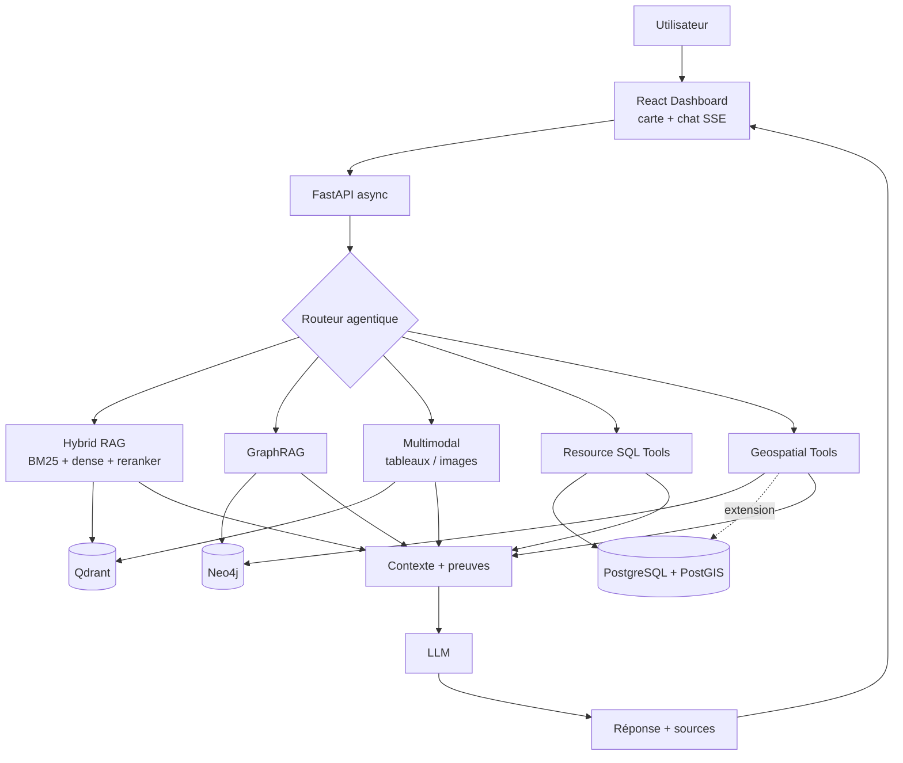

# SurvivalOps Tunisia

Assistant décisionnel de gestion de crise pour opérateurs de protection civile, illustré par un scénario fictif d'apocalypse zombie sur une carte de la Tunisie.

> Projet Fédérateur IA & Big Data (M2) — scénario fictif, connaissances et méthodes réelles. Simulation pédagogique : ne remplace pas les services d'urgence.

## Vision produit

L'opérateur pose une question en langage naturel (par exemple « Nous sommes 150 survivants avec 8 jours de nourriture, une épidémie est signalée près de l'abri Alpha, que faire ? »). Le système :

1. **route** la question vers le bon outil (agent) ;
2. **récupère les preuves** dans les guides d'urgence (RAG hybride + reranker) ;
3. **calcule** les stocks et besoins (SQL, aucun chiffre inventé par le LLM) ;
4. **explore le graphe** abris / routes / menaces (Neo4j) ;
5. **répond en streaming** avec citations, et met à jour un tableau de bord cartographique.

## Périmètre

Une plateforme intégrée qui démontre Hybrid RAG, GraphRAG, RAG multimodal (tranche limitée) et routage agentique contrôlé dans un seul scénario, avec une zone pilote Grand Tunis. **Tous les événements et états d'abris sont générés et fictifs.** La carte donne un contexte géographique, pas de menace en temps réel.

## Architecture

```
React (carte Leaflet + chat SSE)
        │
FastAPI async (Pydantic v2)
        │
Routeur agentique ──┬── RAG hybride : Qdrant (dense + BM25) + Cross-Encoder
                    ├── SQL : PostgreSQL + PostGIS (inventaire, calculs)
                    ├── Graphe : Neo4j (abris, routes, menaces)
                    ├── Géospatial : find_safe_route (Neo4j, PostGIS en extension)
                    └── Multimodal (tranche) : tableaux et images indexés dans Qdrant
        │
LLM + réponse citée      Évaluation : Ragas · Traçage : Langfuse
```

Schéma d'architecture (rendu automatiquement par GitHub) :



## Structure du dépôt

```
.github/workflows/   CI (ruff + pytest)
backend/
  api/               FastAPI async, streaming SSE
  agents/            routeur et outils (RAG, SQL, graphe, géospatial)
  sim/               générateur d'événements simulés
  tests/             pytest
ingestion/           extraction, chunking, embeddings, chargement Qdrant
frontend/            React + Leaflet
data/
  raw/               corpus brut (guides PDF, FEMA, GeoJSON)
  processed/         données nettoyées (ignorées par Git)
docs/                cadrage, backlog, architecture, choix techniques, évaluation
docker-compose.yml   Qdrant + PostgreSQL/PostGIS + Neo4j
.env.example         variables d'environnement (jamais de secret réel)
```

## Démarrage rapide

```bash
cp .env.example .env        # puis remplir les valeurs (ne jamais committer .env)
docker compose up -d        # Qdrant, PostgreSQL, Neo4j
```

Qdrant : http://localhost:6333/dashboard · Neo4j : http://localhost:7474

## Équipe et responsabilités

| Membre | Rôle principal | Responsabilités |
|---|---|---|
| Membre A | IA / RAG | Ingestion, Qdrant, retrieval hybride, reranker, routeur, évaluation Ragas |
| Membre B | Data / Fullstack | PostgreSQL, Neo4j, simulation, API, frontend/carte, CI/CD, Docker |

Revue croisée obligatoire : chaque Pull Request est relue par l'autre membre.

## Conventions Git

- Branches : `main` (stable), `dev`, `feat/<sujet>`, `fix/<sujet>`.
- Commits : Conventional Commits (`feat:`, `fix:`, `docs:`, `test:`, `chore:`).
- Aucun secret dans Git ; seul `.env.example` est versionné.

## Documents du projet

- [Fiche de cadrage](docs/fiche_cadrage_projet.md)
- [Backlog MoSCoW](docs/matrice_moscow_backlog.md)
- [Architecture détaillée](docs/architecture.md)
- [Choix de la base vectorielle](docs/choix_base_vectorielle.md)
- [Pitch S1](docs/pitch_s1.md)
- [Guide de travail](docs/guide_de_travail.md)
