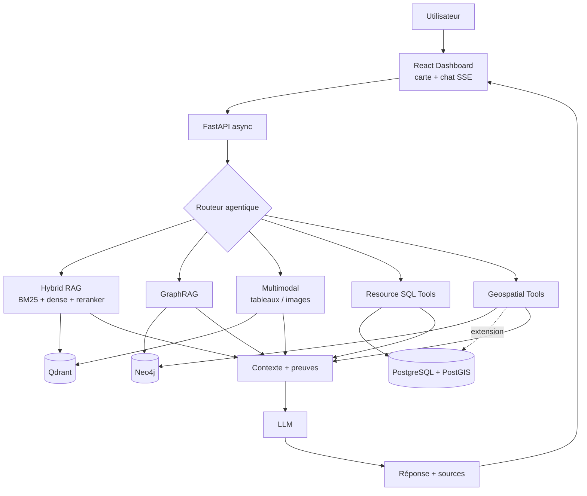

# SurvivalOps Tunisia

Assistant décisionnel de gestion de crise pour opérateurs de protection civile, illustré par un scénario fictif d'apocalypse zombie sur une carte de la Tunisie.

> Projet Fédérateur IA & Big Data (M2) — scénario fictif, connaissances et méthodes réelles. Simulation pédagogique : ne remplace pas les services d'urgence.

## Vision produit

L'opérateur pose une question en langage naturel (par exemple « Nous sommes 150 survivants avec 8 jours de nourriture, une épidémie est signalée près de l'abri Alpha, que faire ? »). Le système :

1. **route** la question vers le bon outil (agent) ;
2. **récupère les preuves** dans les guides d'urgence (RAG hybride + reranker) ;
3. **calcule** les stocks et besoins (SQL, aucun chiffre inventé par le LLM) ;
4. **explore le graphe** abris / routes / menaces (Neo4j) ;
5. **répond en streaming** avec citations, et met à jour un tableau de bord cartographique.

## Périmètre

Une plateforme intégrée qui démontre Hybrid RAG, GraphRAG, RAG multimodal (tranche limitée) et routage agentique contrôlé dans un seul scénario, avec une zone pilote Grand Tunis. **Tous les événements et états d'abris sont générés et fictifs.** La carte donne un contexte géographique, pas de menace en temps réel.

## Architecture

```
React (carte Leaflet + chat SSE)
        │
FastAPI async (Pydantic v2)
        │
Routeur agentique ──┬── RAG hybride : Qdrant (dense + BM25) + Cross-Encoder
                    ├── SQL : PostgreSQL + PostGIS (inventaire, calculs)
                    ├── Graphe : Neo4j (abris, routes, menaces)
                    ├── Géospatial : find_safe_route (Neo4j, PostGIS en extension)
                    └── Multimodal (tranche) : tableaux et images indexés dans Qdrant
        │
LLM + réponse citée      Évaluation : Ragas · Traçage : Langfuse
```

Schéma d'architecture (rendu automatiquement par GitHub) :



## Structure du dépôt

```
.github/workflows/   CI (ruff + pytest)
backend/
  api/               FastAPI async, streaming SSE
  agents/            routeur et outils (RAG, SQL, graphe, géospatial)
  sim/               générateur d'événements simulés
  tests/             pytest
ingestion/           extraction, chunking, embeddings, chargement Qdrant
frontend/            React + Leaflet
data/
  raw/               corpus brut (guides PDF, FEMA, GeoJSON)
  processed/         données nettoyées (ignorées par Git)
docs/                cadrage, backlog, architecture, choix techniques, évaluation
docker-compose.yml   Qdrant + PostgreSQL/PostGIS + Neo4j
.env.example         variables d'environnement (jamais de secret réel)
```

## Démarrage rapide

```bash
cp .env.example .env        # puis remplir les valeurs (ne jamais committer .env)
docker compose up -d        # Qdrant, PostgreSQL, Neo4j
```

Qdrant : http://localhost:6333/dashboard · Neo4j : http://localhost:7474

## Backlog MoSCoW

Jalon final : **séance 7 (soutenance)**. MVP gelé à la fin de la semaine 1. Détail complet et critères d'acceptation : [docs/matrice_moscow_backlog.md](docs/matrice_moscow_backlog.md).

### Must Have (indispensables)

| ID | User Story | Critère d'acceptation clé | Qui | Sem. |
|---|---|---|---|---|
| M1 | Ingestion et chunking des guides | ≥ 15 docs, parent-document, métadonnées `source/type/page`, `make ingest` | A | 2 |
| M2 | Recherche hybride + reranker | Qdrant dense + BM25, RRF, Cross-Encoder, Recall@5 ≥ 0,80 | A | 3 |
| M3 | Besoins calculés depuis l'inventaire | PostgreSQL ; 150 survivants / 30 jours → eau ≈ 17 033 L, 100 % de justesse | B | 3 |
| M4 | Graphe d'abris, routes et menaces | Neo4j ≥ 10 abris/hôpitaux, ≥ 20 routes pondérées, chemin évitant une zone infectée | B | 3–4 |
| M5 | Routeur RAG / SQL / Graphe | Précision ≥ 90 % sur 50 questions, décision journalisée | A | 4–5 |
| M6 | Réponse citée en streaming | FastAPI async, SSE, 1er token < 800 ms, citations des chunks | A | 3–5 |
| M7 | Tableau de bord | React + Leaflet (24 gouvernorats, zoom Grand Tunis), chat avec citations, « fictif » | B | 4–6 |
| M8 | CI/CD | GitHub Actions : ruff + pytest, `main` protégée, Conventional Commits | B | 2 |
| M9 | Environnement reproductible | `docker compose up` : Qdrant + PostgreSQL + Neo4j | B | 1–2 |
| M10 | Évaluation du RAG | BM25 / dense / hybride / hybride + reranker sur ≥ 50 questions | A | 6 |
| M11 | Outil géospatial `find_safe_route` | Interface stable, version MVP sur Neo4j, appelée par le routeur | B | 4 |

### Should Have

| ID | User Story | Critère d'acceptation clé |
|---|---|---|
| S1 | Évaluation continue Ragas (Langfuse) | Faithfulness ≥ 0,85, scores sauvegardés |
| S2 | Cache sémantique Redis | Latence réduite d'au moins 50 % sur requêtes en cache |
| S3 | Garde-fous : PII et refus si preuve insuffisante | « Information non disponible » si score < seuil, 10 cas pièges |
| S4 | Générateur d'événements d'épidémie simulés | ≥ 500 événements reproductibles (seed fixe) |

### Could Have

| ID | User Story |
|---|---|
| C1 | Mode jeu : bouton « Jour suivant » (consommation, propagation) |
| C2 | Plan de survie multi-étapes (RAG + SQL + graphe dans une réponse) |
| C3 | Prédiction de rupture de stock |
| C4 | Manifestes Kubernetes |
| C5 | Requêtes PostGIS derrière l'interface géospatiale de M11 |
| C6 | Tranche multimodale : tableaux et quelques images/cartes |

Ordre de coupe en cas de retard : C1, C6, C5, puis C3.

### Won't Have (exclus du MVP)

- Fine-tuning d'un LLM.
- Import complet d'OpenStreetMap et routage routier réel (pgRouting).
- Plusieurs LLM et frameworks d'orchestration supplémentaires.
- Agent autonome de planification (le routeur reste contrôlé).
- Profils de survivants complets, authentification multi-utilisateurs, facturation.
- Moteur de jeu 3D.

## Équipe et responsabilités

| Membre | Rôle principal | Responsabilités |
|---|---|---|
| Yasmine Mizouri | IA / RAG | Ingestion, Qdrant, retrieval hybride, reranker, routeur, évaluation Ragas |
| Ayoub Louati | Data / Fullstack | PostgreSQL, Neo4j, simulation, API, frontend/carte, CI/CD, Docker |

Revue croisée obligatoire : chaque Pull Request est relue par l'autre membre.

## Conventions Git

- Branches : `main` (stable), `dev`, `feat/<sujet>`, `fix/<sujet>`.
- Commits : Conventional Commits (`feat:`, `fix:`, `docs:`, `test:`, `chore:`).
- Aucun secret dans Git ; seul `.env.example` est versionné.

## Documents du projet

- [Fiche de cadrage](docs/fiche_cadrage_projet.md)
- [Backlog MoSCoW](docs/matrice_moscow_backlog.md)
- [Architecture détaillée](docs/architecture.md)
- [Choix de la base vectorielle](docs/choix_base_vectorielle.md)
- [Pitch S1](docs/pitch_s1.md)
- [Guide de travail](docs/guide_de_travail.md)
