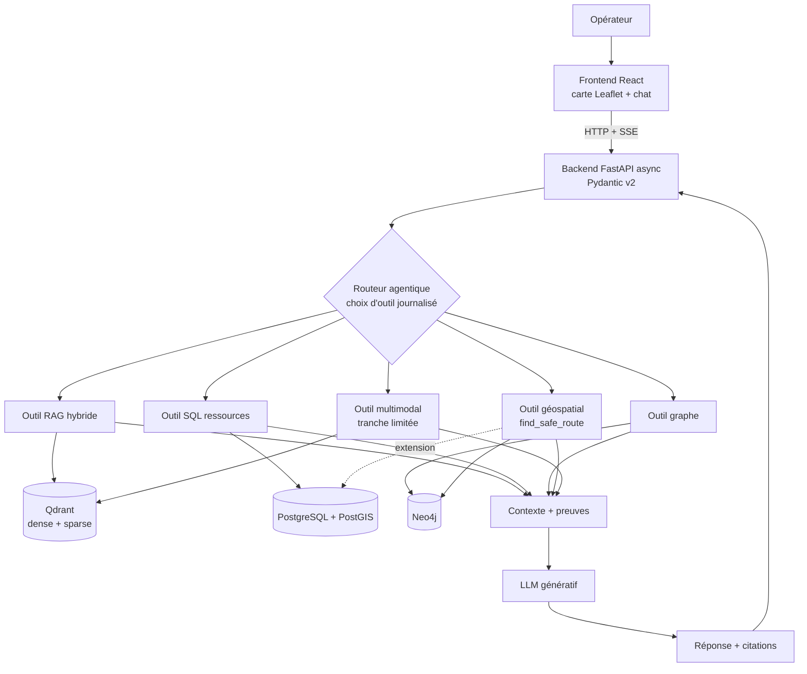
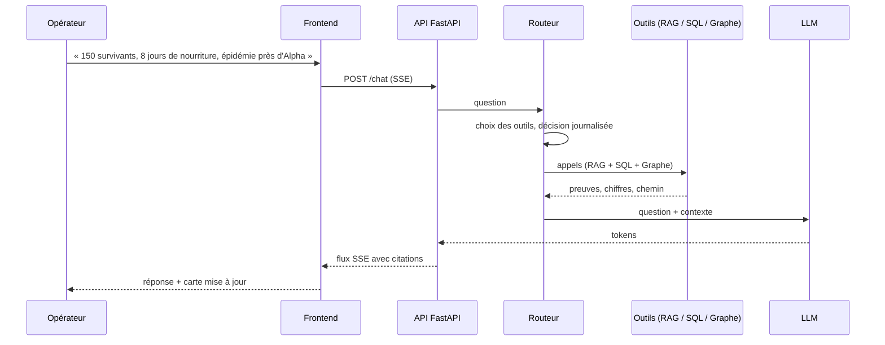
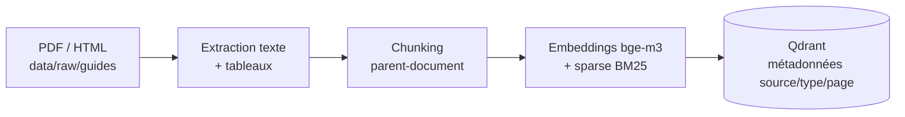

# Architecture de SurvivalOps Tunisia

Plateforme intégrée : une question en langage naturel traverse un routeur agentique contrôlé, qui appelle un ou plusieurs outils, puis une réponse citée est renvoyée en streaming.

## Vue d'ensemble

## Les couches

| Couche | Dossier | Rôle | Technologie |
|---|---|---|---|
| Présentation | `frontend/` | Carte de la Tunisie, zoom Grand Tunis, état des abris, chat avec citations | React, Leaflet |
| API | `backend/api/` | Endpoints, streaming SSE, validation | FastAPI async, Pydantic v2 |
| Orchestration | `backend/agents/` | Routeur RAG / SQL / graphe, combinaison des résultats, journal des décisions | Python, LLM |
| Outils | `backend/agents/` | Un module par outil, interface stable | voir ci-dessous |
| Ingestion | `ingestion/` | PDF/HTML → chunks parent-document → embeddings → bases | bge-m3, Qdrant |
| Simulation | `backend/sim/` | Événements d'épidémie et états d'abris fictifs, seed fixe | Python |
| Données | `data/raw/` | Guides, FEMA, GeoJSON | fichiers |
| Évaluation | `docs/evaluation.md` | Recall@5, Faithfulness, routage | Ragas, Langfuse |

## Les outils et leurs bases

| Outil | Quand le routeur le choisit | Base | Exemple |
|---|---|---|---|
| RAG hybride | Procédure, consigne, définition | Qdrant : dense + BM25, fusion RRF, Cross-Encoder | « Comment purifier l'eau ? » |
| SQL | Quantité, stock, calcul | PostgreSQL | « Eau pour 150 survivants sur 30 jours ? » |
| Graphe | Voisinage, menace, relation | Neo4j | « Quels abris touchent la zone infectée ? » |
| Géospatial | Itinéraire, distance | Neo4j (PostGIS en extension) | `find_safe_route(origine, destination, zones_a_eviter)` |
| Multimodal | Tableau ou image dans un PDF | Qdrant | « Que montre le tableau des rations ? » |

Règle : **aucun chiffre ne vient du LLM**. Les quantités viennent de SQL, les chemins du graphe, les procédures des chunks cités.

## Flux d'une requête

## Pipeline d'ingestion

## Infrastructure locale

`docker compose up -d` lance :

| Service | Ports | Usage |
|---|---|---|
| Qdrant | 6333, 6334 | recherche vectorielle |
| PostgreSQL + PostGIS | 5432 | inventaire, événements, géospatial |
| Neo4j | 7474, 7687 | graphe d'abris, routes, menaces |

CI : GitHub Actions, ruff + pytest à chaque push ; `main` protégée.

## Décisions clés

- **Un routeur contrôlé, pas un agent autonome** : il choisit des outils et combine leurs résultats, il ne planifie pas librement.
- **Interface géospatiale stable** : `find_safe_route` fonctionne sur Neo4j au MVP ; PostGIS peut la remplacer sans changer l'appelant.
- **Qdrant** : filtrage par métadonnées et hybride natifs, un seul conteneur. pgvector en repli (voir `choix_base_vectorielle.md`).
- **Tout est fictif côté événements** : abris, épidémie et états sont générés et étiquetés « fictif ».
